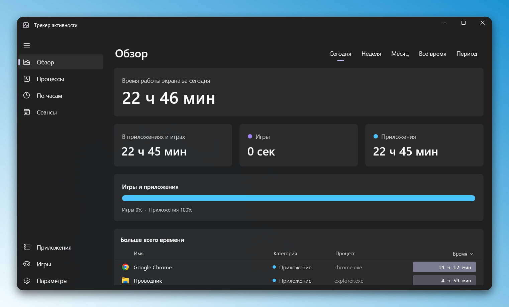
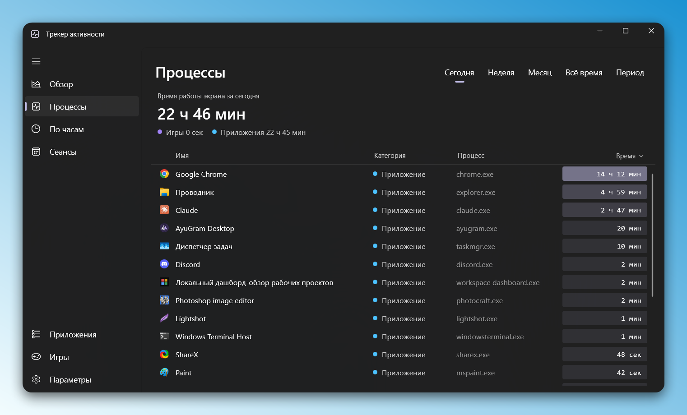
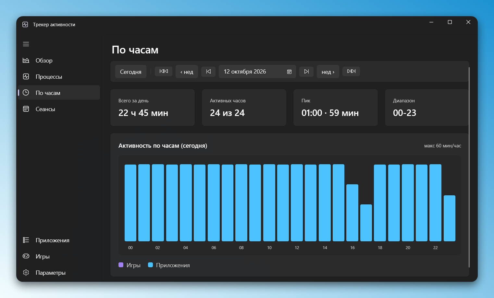
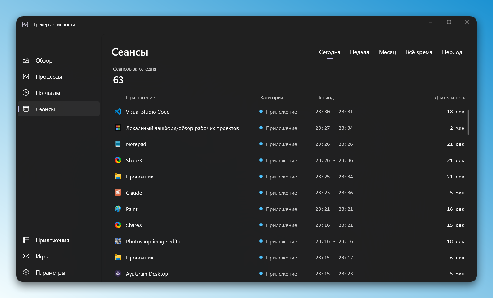

# Windows Activity Tracker

A screen time tracker for Windows. It records which app or game has your focus and for how long, then shows the result in a window styled after the Windows 11 Task Manager.

Everything stays on your machine. There is no account, no network access and no telemetry.

<table>
  <tr>
    <td width="50%"><br><sub>Overview</sub></td>
    <td width="50%"><br><sub>Processes</sub></td>
  </tr>
  <tr>
    <td width="50%"><br><sub>Hourly</sub></td>
    <td width="50%"><br><sub>Sessions</sub></td>
  </tr>
</table>

## What it does

- Counts time per app and per game, based on the window that has focus.
- Tracks total screen time separately, so time in windows that match no app still counts toward the day.
- Pauses while the session is locked or the PC sleeps.
- Separates games from regular apps by install folder (Steam, Epic, GOG, Riot, EA, Ubisoft, Battle.net), by editable lists, or by hand from the right-click menu on a process.
- Groups activity into sessions. Alt-tabbing away or stepping out for a few minutes (five by default) does not end a session.
- Reads app names and icons from the executables themselves.
- Shows seven pages: Overview, Processes, Hourly, Sessions, Apps, Games and Settings. Periods are Today, Week, Month, All time, or any custom date range. The Hourly page opens any day and pages by day, week or month, with a tooltip on every hour.

Idle time is not subtracted. A window that keeps focus counts as active, which is the right call for games, video and long reads.

## How it works

The app is two executables. Both are self-contained, so the .NET runtime and Windows App SDK are bundled and nothing needs installing first.

`WatCounter.exe` is the background counter. It has no window and no tray icon. It polls the foreground window every 3 seconds, writes to a local SQLite database, and uses roughly 16 to 20 MB of memory with close to zero CPU. It starts at sign-in.

`WinActivityTracker.exe` is the dashboard. It is a WinUI 3 window with a Mica backdrop and a tray icon, and it only reads the database. Launching it a second time brings the open window forward instead of starting another copy. Closing it, or choosing Exit in the tray, leaves the counter running.

Autostart is a `HKCU\...\Run` entry named "Windows Activity Tracker - Counter", so it appears under Startup apps in Task Manager and can be switched there. Turning it off stops the counting: the counter will not start at sign-in, and an already running one exits within about 15 seconds. When the counter is off, the dashboard shows a banner with a button to turn it back on.

## Data

Everything lives in `%USERPROFILE%\AppData\Local\WinActivityTracker`:

- `activity.db`, the SQLite database. Time is stored in hourly buckets per process, plus a screen time table and a sessions table.
- `config.json`, the settings.
- `tracker.log`.
- `icons\`, cached app icons.

Uninstalling leaves this folder in place. Delete it by hand if you want the history gone.

## Requirements

- Windows 10 1809 or later, x64. Windows 11 is recommended, since the Mica backdrop needs it.
- The interface is in Russian only for now.
- To build: the .NET 10 SDK. To build the installer: Inno Setup 6.

## Build

```
dotnet build -c Release src/WinActivityTracker/WinActivityTracker.csproj
dotnet build -c Release src/WinActivityTracker.Counter/WinActivityTracker.Counter.csproj
```

The counter project compiles the Config, Data, Tracking, Interop and Autostart sources straight from the dashboard project, so the two share one core without a separate library.

## Installer

Publish both projects into `installer/staging`, then compile the script:

```
dotnet publish -c Release --self-contained true -o installer/staging src/WinActivityTracker/WinActivityTracker.csproj
dotnet publish -c Release --self-contained true -o installer/staging src/WinActivityTracker.Counter/WinActivityTracker.Counter.csproj
iscc installer/setup.iss
```

The result is `installer/WinActivityTracker-Setup.exe`, about 60 MB. The version is generated on every build as `1.0.<day of year>.<HHmm>`, and the installer reads it from the executable, so it never needs editing by hand.

The installer asks for admin rights and installs to Program Files. Before installing or uninstalling it stops any running copy of either executable, so a counter running in the background does not block a reinstall. It can register autostart and start the counter when it finishes.

If the project sits in a synced folder such as OneDrive, the output file can get locked mid-build. Pass `/O<folder>` to `iscc` to write it somewhere else.

## Configuration

`config.json` is created on first launch and the counter reloads it whenever it changes.

| Key | Default | Meaning |
| --- | --- | --- |
| `SampleIntervalSeconds` | 3 | How often the foreground window is checked. Range 1 to 60. |
| `SessionGapSeconds` | 300 | How long you can be away from an app before the next visit counts as a new session. Range 30 to 3600. |
| `IgnoredProcesses` | system shell hosts | Executables that are never counted. |
| `ForceGameProcesses` | popular games | Executables always counted as games. |
| `NeverGameProcesses` | browsers, players, editors | Executables never counted as games. |
| `GamePathMarkers` | launcher folders | Path fragments that mark an executable as a game. |
| `TreatFullscreenAsGame` | false | Counts any fullscreen window as a game. Off by default because it misfires on screen recorders and video players. |

A process is classified in this order: ignored, forced game, never a game, install path marker, fullscreen (if enabled), and otherwise a regular app.

## Project layout

```
src/
  WinActivityTracker/            dashboard and shared core
    Config/                      settings, paths, log
    Data/                        SQLite access and statistics
    Tracking/                    foreground polling, classifier, icon cache
    Interop/                     Win32 calls
    Autostart/                   registry autostart and Task Manager state
    Pages/, Ui/                  views
  WinActivityTracker.Counter/    background counter entry point
installer/
  setup.iss                      Inno Setup script
```

## License

MIT. See [LICENSE](LICENSE).

## Built with

C# on .NET 10, WinUI 3 (Windows App SDK), Win32 APIs for window tracking, SQLite through Microsoft.Data.Sqlite, H.NotifyIcon for the tray, and Inno Setup for the installer.
